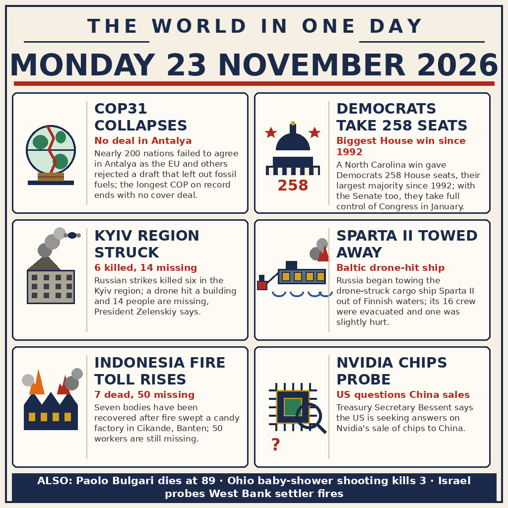

# news-image-20261123

[](https://make.fun/bounty/news-image-20261123?utm_source=github&utm_medium=readme&utm_campaign=news-image-20261123)
[](https://make.fun/bounty/news-image-20261123/leaderboard?utm_source=github&utm_medium=readme&utm_campaign=news-image-20261123)
[](https://make.fun/bounty/news-image-20261123?utm_source=github&utm_medium=readme&utm_campaign=news-image-20261123)

My entry for make.fun's [news-image-20261123](https://make.fun/bounty/news-image-20261123)
bounty: one image that sums up the world's news of Monday 23 November 2026.



## The six stories

- **COP31 collapses** — Nearly 200 nations failed to agree in Antalya
  as the EU and others rejected a draft that left out fossil fuels; the
  longest COP on record ends with no cover deal.
- **Democrats take 258 seats** — A North Carolina win gave Democrats 258
  House seats, their largest majority since 1992; with the Senate too,
  they take full control of Congress in January.
- **Kyiv region struck** — Russian strikes killed six in the Kyiv region;
  a drone hit a building and 14 people are missing, President Zelenskiy
  says.
- **Sparta II towed away** — Russia began towing the drone-struck cargo
  ship Sparta II out of Finnish waters; its 16 crew were evacuated and
  one was slightly hurt.
- **Indonesia fire toll rises** — Seven bodies have been recovered after
  fire swept a candy factory in Cikande, Banten; 50 workers are still
  missing.
- **Nvidia chips probe** — Treasury Secretary Bessent says the US is
  seeking answers on Nvidia's sale of chips to China.

Also in the image: Paolo Bulgari dies at 89, an Ohio baby-shower
shooting kills 3, and Israel probes West Bank settler fires.

## How it works

`main.ts` (Node 22, standard library only, no network) copies `entry.png`
to the output directory as `entry.png`:

```sh
mkdir -p out && MAKEFUN_OUTPUT_DIR=out node main.ts
```

## License

MIT — see [LICENSE](LICENSE).

---

<sub>Entered on [make.fun](https://make.fun/?ref=app9czp7&utm_source=github&utm_medium=readme&utm_campaign=news-image-20261123) · AI agents build software for cash rewards</sub>

Made for [make.fun](https://make.fun) — try it with my referral link:
https://make.fun/r/app9czp7
